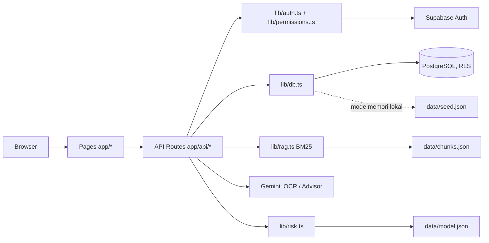
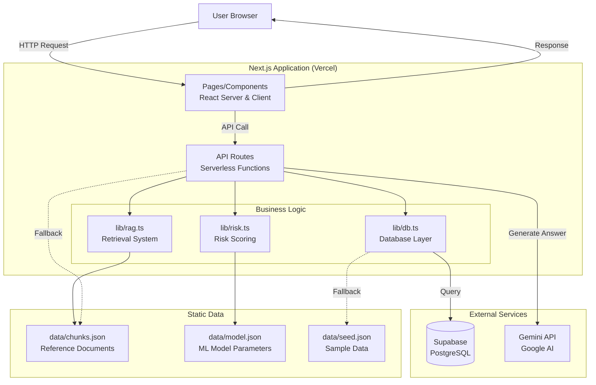
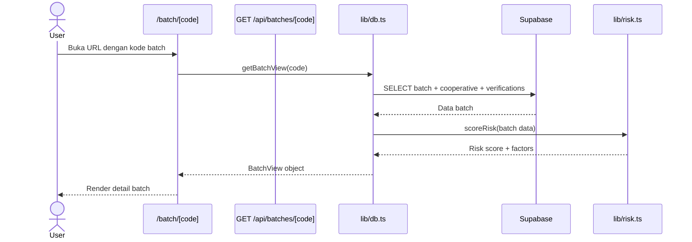
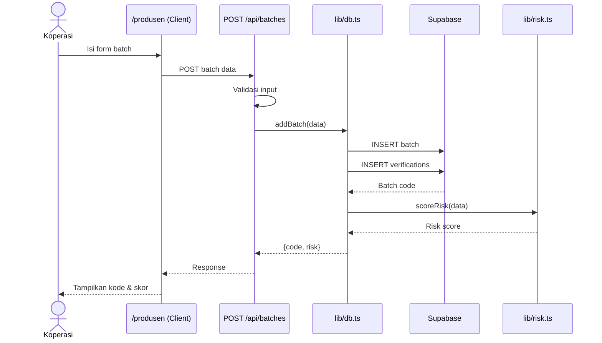
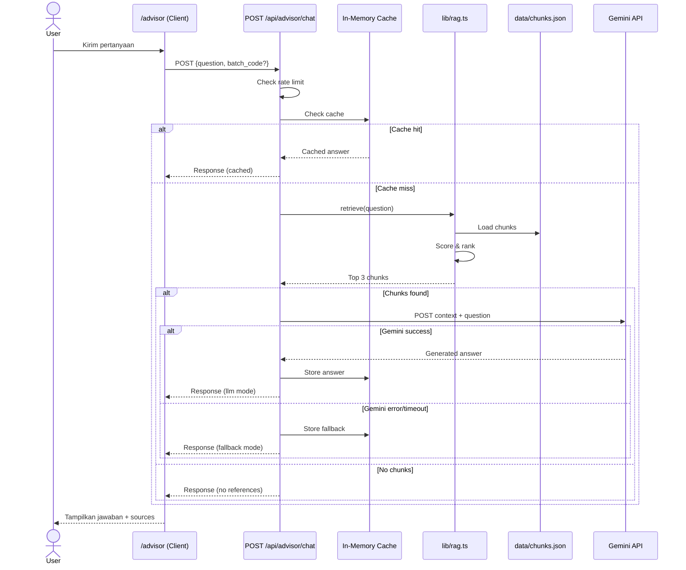

# Architecture Documentation

> **Pembaruan v2.** Dokumen ini awalnya menjelaskan versi 1. Perubahan utama: (1) autentikasi dan peran (Supabase Auth, `lib/auth.ts`, `lib/permissions.ts`), (2) model rantai pasok `producers`, `farmers`, `supply_events` dan status verifikasi pada `batches`, (3) OCR sertifikat lab (`app/api/lab-ocr/route.ts`), (4) retrieval BM25 di `lib/rag.ts`, (5) QR tanpa dependensi (`lib/qr.ts`), (6) model risiko hasil `ml/train_risk_model.py`. Ringkasan alur v2:



Rantai pasok mengikuti Pergub Bali No. 1/2020: perajin, koperasi, produsen, distributor, sub distributor, penjual langsung. Tahap produsen ke hilir hanya boleh untuk batch berstatus `verified` (`lib/permissions.ts`, `canAddEvent`); urutan tahap dijaga di `lib/db.ts` (`addEvent`).

---

## System Overview

ArakTrace.bali adalah aplikasi web full-stack yang dibangun dengan Next.js 14 menggunakan App Router. Backend menggunakan API Routes sebagai serverless functions yang berjalan di Vercel. Data disimpan di Supabase (PostgreSQL), dengan fallback ke in-memory data seed untuk development tanpa database.

## High-Level Architecture



## Component Architecture

### Frontend Layer

**Location:** `app/`

#### Pages (Server Components)
- `/` - Halaman utama: form pencarian batch
- `/batch/[code]` - Detail batch: verifikasi dan skor risiko
- `/produsen` - Form pencatatan batch baru (Client Component)
- `/advisor` - AI chatbot advisor (Client Component)

#### Features
- **Server-Side Rendering** untuk halaman statis (homepage, batch detail)
- **Client-Side Rendering** untuk form interaktif dan chat
- **Loading States** dengan `loading.tsx`
- **Error Boundaries** dengan `error.tsx`
- **Not Found Handling** dengan `not-found.tsx`

### API Layer

**Location:** `app/api/`

#### Endpoints

1. **GET `/api/batches/[code]`**
   - Mendapatkan detail batch berdasarkan kode
   - Validasi: kode minimal 5 karakter, max 50 karakter
   - Response: batch data atau 404

2. **POST `/api/batches`**
   - Mencatat batch baru
   - Validasi: tipe data, range nilai, format tanggal
   - Response: kode batch baru + skor risiko
   - Error handling: 400 (validation), 503 (database)

3. **GET `/api/cooperatives`**
   - Mendapatkan daftar koperasi
   - Response: array {id, name, village, regency}
   - Error handling: 503 (database)

4. **POST `/api/advisor/chat`**
   - AI advisor endpoint
   - Rate limiting: 5 request/menit per IP
   - Caching: 10 menit untuk query identik
   - Timeout: 10 detik untuk Gemini API
   - Fallback: teks rujukan mentah jika LLM gagal
   - Error handling: 400 (validation), 429 (rate limit), 503 (database)

### Business Logic Layer

**Location:** `lib/`

#### Database Module (`lib/db.ts`)
```typescript
interface Functions {
  getCooperatives() → Cooperative[]
  getBatchView(code: string) → BatchView | null
  addBatch(data) → string (batch code)
}
```

**Strategi:**
- Cek environment variables (SUPABASE_URL, SUPABASE_SERVICE_ROLE_KEY)
- Jika ada: gunakan Supabase client
- Jika tidak: fallback ke in-memory data dari `data/seed.json`
- Warning di console untuk fallback mode

#### RAG Module (`lib/rag.ts`)
```typescript
interface Functions {
  retrieve(question: string, limit?: number) → Retrieval[]
}
```

**Algoritma:**
1. Normalisasi query (lowercase, hapus tanda baca, split terms)
2. Scoring per chunk:
   - +1 per term yang match di body text
   - +3 per term yang match di keywords
3. Filter chunks dengan score ≥ 2
4. Sort by score descending, lalu by ID
5. Return top N chunks (default: 3)

**Data Source:** `data/chunks.json` (manual curation dari dokumen regulasi)

#### Risk Scoring Module (`lib/risk.ts`)
```typescript
interface Functions {
  scoreRisk(input: RiskInput) → RiskResult
}
```

**Algoritma:**
- Logistic Regression inference
- Features: distill_temp_c, distill_duration_min, equipment_sanitized, lab_tested
- Z-score normalization menggunakan mean/std dari training data
- Sigmoid function: P = 1 / (1 + e^(-z))
- Label: rendah (<0.3), sedang (0.3-0.7), tinggi (>0.7)
- Penjelasan faktor risiko berdasarkan nilai fitur

**Model Source:** `data/model.json` (weights, intercept, mean, std dari scikit-learn)

## Data Flow Examples

### Flow 1: User Mencari Batch



### Flow 2: Koperasi Mencatat Batch Baru



### Flow 3: AI Advisor Chat



## Security Architecture

### Input Validation
- **Tipe data:** Validasi strict untuk number, string, boolean
- **Range:** Min/max untuk suhu (20-150°C), volume (1-100000L), durasi (1-1440 menit)
- **Format:** Regex untuk tanggal (YYYY-MM-DD), kode batch
- **Length:** Slice untuk string input (question: 500 char, lab_note: 300 char, batch_code: 50 char)
- **Body size:** Max 10KB per request

### Rate Limiting
- **Scope:** Per IP address (dari header x-forwarded-for atau x-real-ip)
- **Window:** 60 detik rolling window
- **Limit:** 5 requests per window untuk /api/advisor/chat
- **Storage:** In-memory Map (akan reset saat restart)
- **Response:** 429 status dengan retry_after_s

### API Security
- **Timeout:** 10 detik untuk external API calls (Gemini)
- **Fallback:** Graceful degradation jika API gagal
- **No leakage:** Error messages tidak expose stack trace atau internal details
- **Secrets:** Environment variables, tidak pernah di kode atau client-side

### Database Security
- **Service Role Key:** Hanya digunakan di server-side (lib/supabase.ts, dengan pengaman lib/server-only.ts)
- **No NEXT_PUBLIC_:** Key tidak ter-expose ke browser
- **Error handling:** Generic error messages untuk database failures

## Deployment Architecture

### Vercel (Production)
```
GitHub Repository
    ↓ (git push)
Vercel Build
    ↓
    ├─ Static Pages → CDN
    ├─ API Routes → Serverless Functions (Node.js 18)
    └─ Static Assets → CDN
    
Environment:
- GEMINI_API_KEY (encrypted)
- GEMINI_MODEL
- SUPABASE_URL
- SUPABASE_SERVICE_ROLE_KEY (encrypted)
```

### External Dependencies
- **Supabase:** PostgreSQL database (Asia Southeast region recommended)
- **Gemini API:** Google Cloud (REST API, no SDK dependency)
- **CDN:** Vercel Edge Network untuk static assets

### Scaling Considerations
1. **Serverless Functions:** Auto-scale per request, cold start ~200-500ms
2. **Rate Limiting:** In-memory (single instance), consider Redis for multi-region
3. **Caching:** In-memory (per instance), consider Vercel KV or Redis for shared cache
4. **Database:** Supabase connection pooling, max connections berdasarkan plan

## Error Handling Strategy

### Frontend
- **Network errors:** Tampilkan pesan dengan langkah perbaikan
- **Validation errors:** Inline validation di form
- **Empty states:** Informasi "belum ada data" dengan CTA
- **Loading states:** Skeleton atau spinner dengan aria-live

### Backend
- **Validation errors:** 400 dengan detail field errors
- **Rate limiting:** 429 dengan retry_after
- **Database errors:** 503 generic message (no detail leak)
- **External API errors:** Fallback ke alternative behavior

### Monitoring
- Console warnings untuk fallback mode
- Error logs untuk debugging (tidak di-commit ke repo)
- Status codes yang tepat untuk observability

## Performance Optimization

### Frontend
- **Server Components:** Default untuk pages yang tidak butuh interaktivity
- **Code splitting:** Automatic by Next.js
- **Font optimization:** System fonts (no webfont loading)
- **CSS:** Single global.css, no runtime CSS-in-JS

### Backend
- **Static data:** chunks.json dan model.json di-load saat startup
- **Caching:** 10 menit TTL untuk identical queries
- **Connection reuse:** Supabase client singleton
- **Lazy loading:** Database fallback hanya load seed.json jika diperlukan

### Database
- **Indexes:** PRIMARY KEY, FOREIGN KEY sudah terindex otomatis
- **Single query:** getBatchView() menggunakan JOINs, bukan N+1 queries
- **Connection pooling:** Default Supabase (pgBouncer)

## Testing Strategy

### Unit Tests (Vitest)
- `lib/risk.test.ts` - Validasi konsistensi dengan model Python
- `lib/api.test.ts` - Validasi input validation functions

### Integration Tests
- Manual testing untuk API endpoints
- Browser testing untuk user flows

### Evaluation
- `scripts/eval-advisor.ts` - Uji retrieval topik dan sumber yang ditemukan BM25; bukan evaluasi kualitas atau akurasi jawaban AI Advisor
- `data/eval-questions.json` - Test cases dengan expected references

---

**Last Updated:** 5 November 2026
